# Chameleon — 3 art directions (pick one)

Open this file in the VS Code Markdown preview to see the images.

| | A. Bold flat party poster | B. Premium dark app | C. Nature-documentary field guide ⭐ |
|---|---|---|---|
| Laptop lobby | 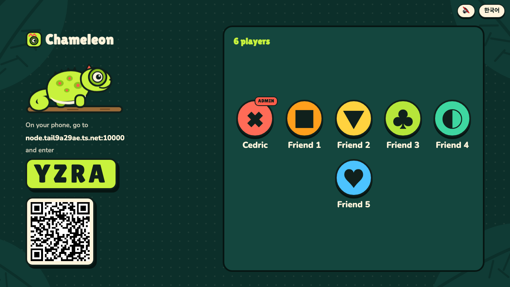 | 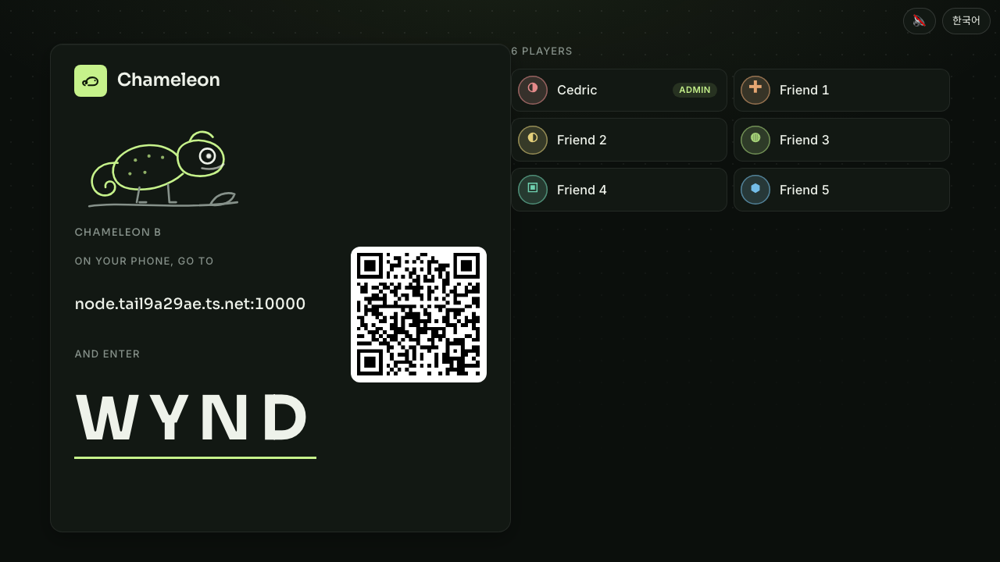 | 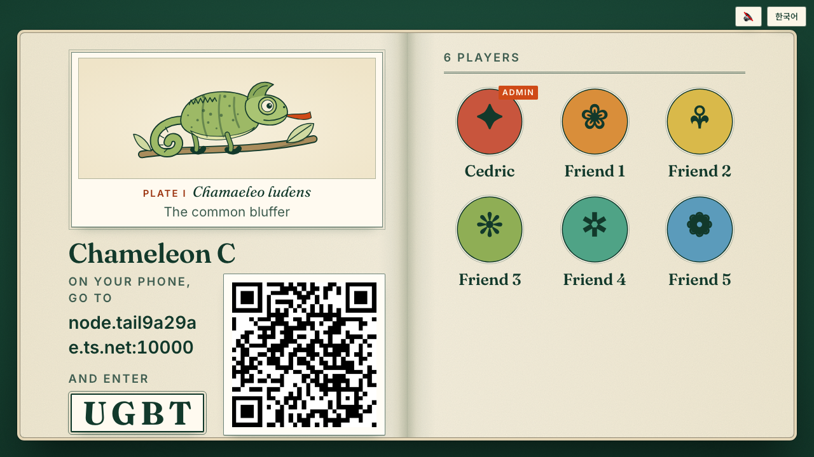 |
| Laptop play | 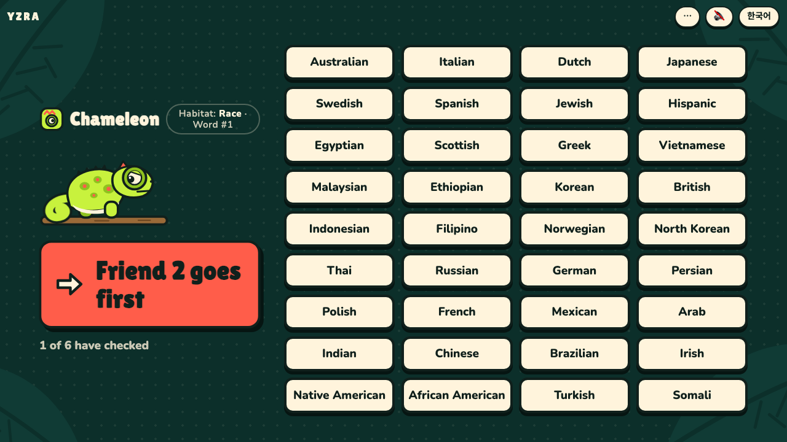 | 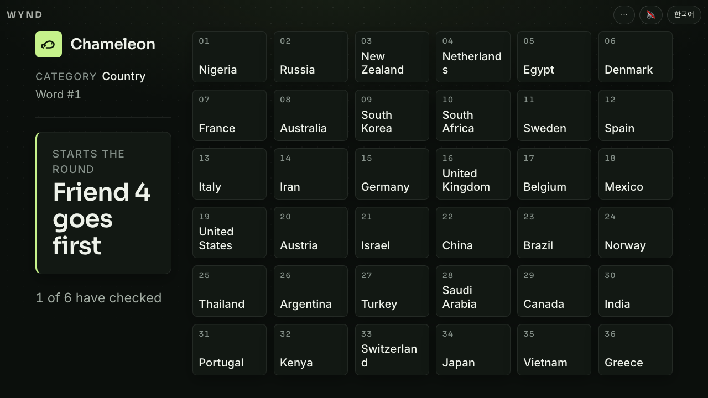 | 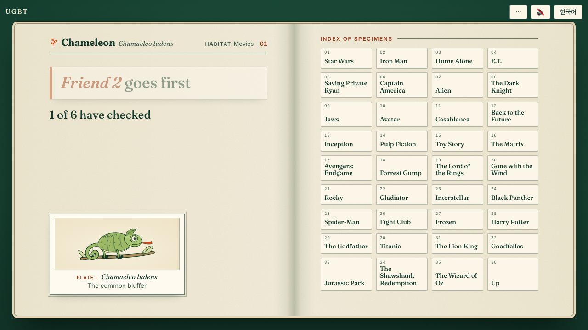 |
| Laptop result | 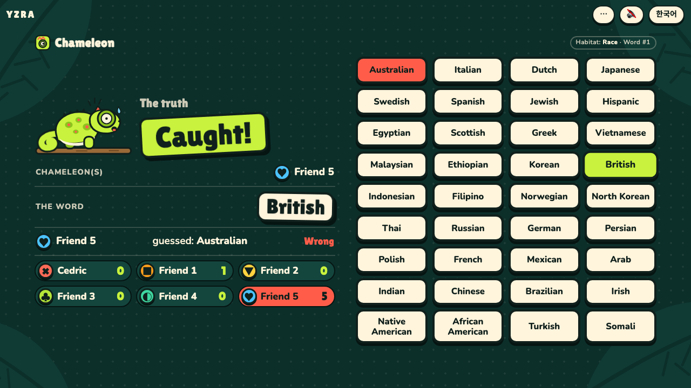 | 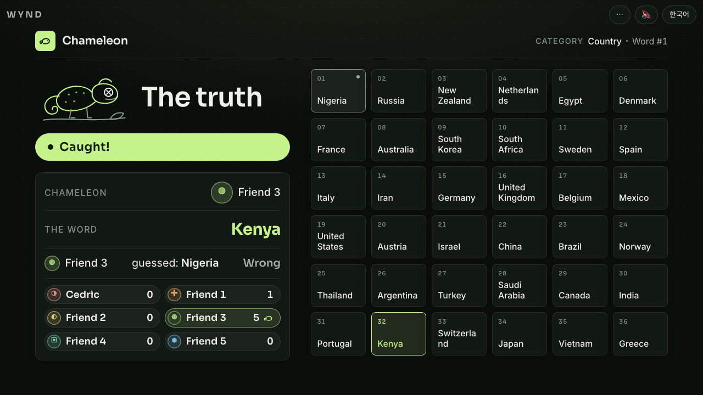 | 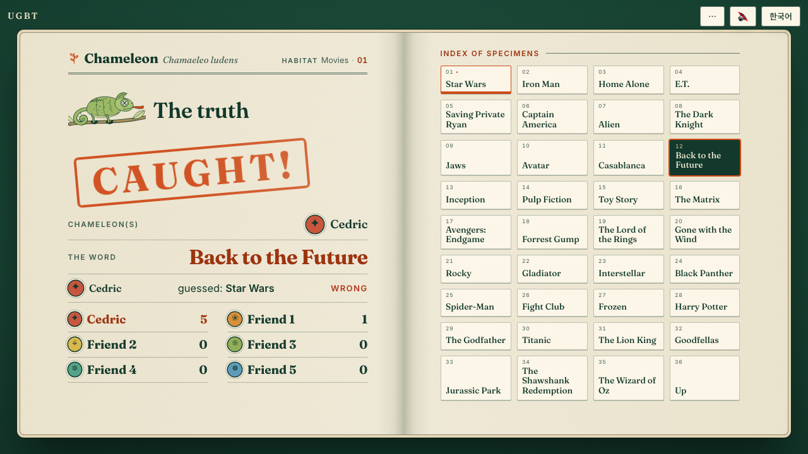 |
| Phone (secret card held) | 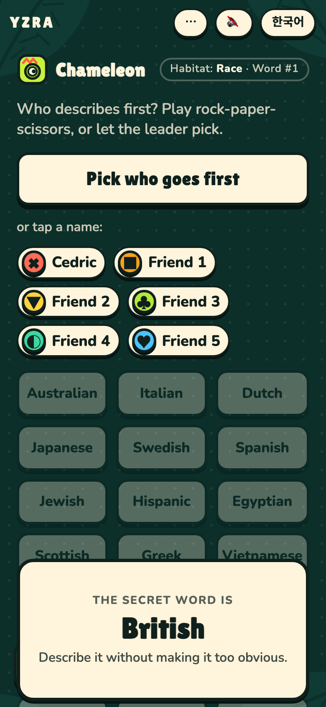 | 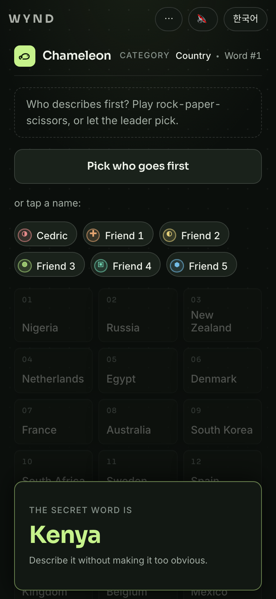 | 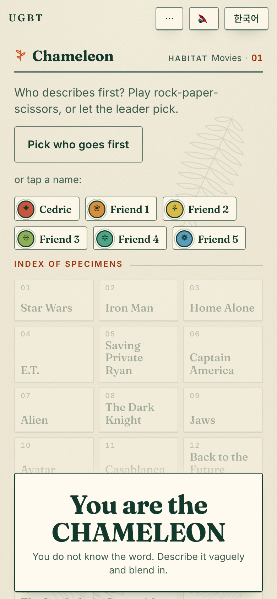 |

Judge panel (3 reviewers, read-only): **C wins 3–0** (scores C 8 / 7.5 / 8, A 6–7, B 5–6.5). Steal from A: bigger, higher-contrast laptop tiles and the mascot emotes; from B: tabular numerals, two-column vote list for crowds, no mid-word breaks.
Source folders (temporary copies): `games/chameleon-a`, `-b`, `-c`.
